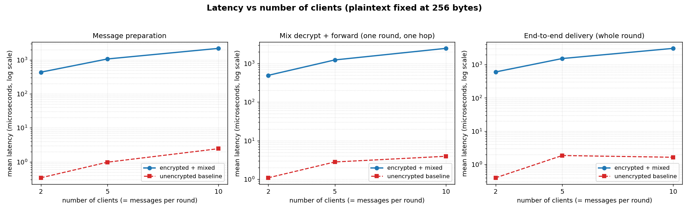
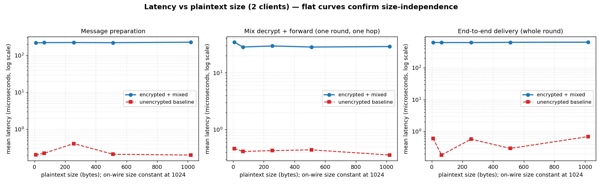
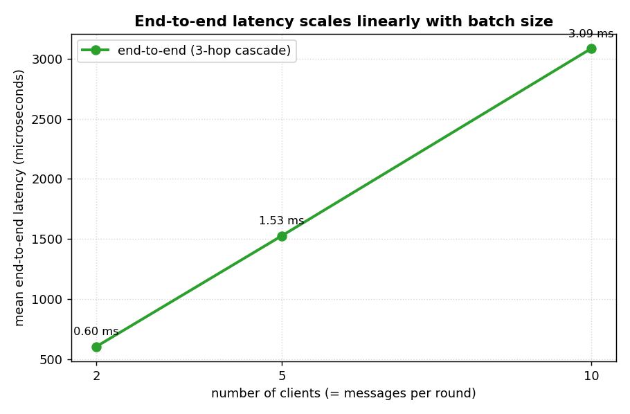

# A Chaum-Style Mix Network in Go

A re-implementation of David Chaum's 1981 mix network: multiple clients route
fixed-length, onion-encrypted messages through a cascade of three mix servers
that batch, decrypt one layer, shuffle, and forward each round, so that no
single party — not even a participating mix — can link a sender to a recipient.
Servers communicate over gRPC secured with server-authenticated TLS and run in
isolated Docker containers.

---

## 1. Architecture and Design

### 1.1 Components

The system is a single Go binary, `mixnet`, that selects a role at runtime. The
same image therefore serves every container; only environment variables and the
command differ.

| Role | How it is selected | Responsibility |
|------|--------------------|----------------|
| Mix server | `ROLE=mix` + `SERVER_ID=serverN` (no command) | Receive packets, drop replays, peel one layer, batch per round, shuffle, forward |
| Exit mix | additionally `FINAL_MIX=true` (server3) | As above, plus store recipient blobs and write per-round output files |
| Client | command `client --id … --recipient … --path …` | Build onions (`prepare_message`), submit to the first mix, poll the exit mix and decrypt locally (`poll_messages`) |
| Keygen | command `keygen` | Generate every party's X25519 keypair into `config/keys` |
| Healthcheck | command `healthcheck --id serverN` | Dial the server's own TLS port and issue a `Health` RPC (used by Docker) |

Three mixes (`server1 → server2 → server3`) form a fixed cascade; `server3` is
the exit. Two clients (`client1`, `client2`) take part in the demo. All
parameters live in a single JSON config mounted into every container at
`/app/config/config.json`.

### 1.2 Data flow for one message

```
 client1                server1            server2            server3 (exit)        client2
   │                       │                  │                   │                    │
   │ BuildOnion(msg,       │                  │                   │                    │
   │   recipient=client2,  │                  │                   │                    │
   │   path=[s1,s2,s3],    │                  │                   │                    │
   │   round=r)            │                  │                   │                    │
   │── ForwardMessage ────▶│                  │                   │                    │
   │     (3-layer onion)   │ peel L1, buffer  │                   │                    │
   │                       │ …wait for round… │                   │                    │
   │                       │ shuffle batch    │                   │                    │
   │                       │── ForwardMessage▶│ peel L2, buffer   │                    │
   │                       │   (2-layer onion)│ …wait, shuffle…   │                    │
   │                       │                  │── ForwardMessage ▶│ peel L3 → deliver  │
   │                       │                  │   (1-layer onion) │ store blob,        │
   │                       │                  │                   │ write round_r.txt  │
   │                       │                  │                   │◀── PollMessages ───│
   │                       │                  │                   │── blob ───────────▶│
   │                       │                  │                   │   OpenFromRecipient│
   │                       │                  │                   │   → plaintext      │
```

Each mix performs identical logic; the only special case is the exit mix, which
delivers to a recipient mailbox instead of relaying. The cascade is driven
synchronously through the gRPC chain: a mix forwards a round's whole batch in
one burst once the batch is complete.

### 1.3 Repository layout

```
mixnet/
├── main.go                     # subcommand dispatch + environment/flag wiring
├── go.mod                      # module mixnet; pins gRPC + protobuf
├── Dockerfile                  # multi-stage build (go mod tidy → static binary)
├── docker-compose.yml          # 3 mixes + 2 clients, TLS/config/output mounts
├── setup.sh                    # one-command demo: certs → build → keygen → run
├── config/
│   └── config.json             # round size, timeout, padding, parties, keys
├── proto/
│   ├── mixnet.proto            # gRPC service definition
│   ├── mixnet.pb.go            # generated messages
│   └── mixnet_grpc.pb.go       # generated client/server stubs
├── internal/
│   ├── onion/                  # onion crypto (KEM/DEM, padding, replay digest)
│   │   ├── crypto.go           #   X25519 + HKDF-SHA256 + AES-256-GCM
│   │   ├── onion.go            #   BuildOnion / Peel / wire format
│   │   └── keys.go             #   key (de)serialisation
│   ├── config/                 # config loading and key paths
│   ├── mixcore/                # network-agnostic batching/shuffle/replay engine
│   ├── transport/              # TLS credential helpers
│   ├── mixserver/              # gRPC server: wires mixcore to the network + sink
│   └── client/                 # gRPC client: prepare/send/poll/decrypt
├── bench/                      # in-process benchmark harness (+ results.csv, plots/)
└── scripts/
    ├── gen_certs.sh            # self-signed CA + per-mix server certs (openssl)
    ├── gen_config.py           # scale config to N clients for experiments
    └── plot.py                 # render benchmark figures from results.csv
```

A deliberate design choice is the separation between **`mixcore`** (pure logic:
batching, replay detection, shuffle, relay-vs-deliver routing) and
**`mixserver`** (gRPC, TLS, file I/O). `mixcore` depends only on `onion` and the
standard library, so the entire cascade can be exercised in-process by unit
tests and benchmarks with no network, TLS, or Docker. This is what makes the
benchmark numbers in §4 reproducible in seconds.

---

## 2. API and Encryption Implementation

### 2.1 Client API

`prepare_message(message, recipient_pubkey, mix_pubkeys[], round)` is implemented
by `onion.BuildOnion` (wrapped by `client.Prepare`). It returns the outermost
wire packet:

1. **Innermost (to the recipient).** The plaintext is placed into a
   fixed-length slot — `uint32(len) ‖ message ‖ zero-padding` of
   `padded_payload_size` (1024) bytes — and sealed to the recipient's public key.
   The recipient is the *only* party able to open this layer, which is how a
   client confirms it is the final decryptor.
2. **Mix layers (outermost-last).** For each hop from the exit mix inward, a
   routing header is prepended and the result sealed to that mix's public key.
   The exit mix's header is a `Deliver` instruction naming the recipient; every
   other header is a `Relay` instruction naming the next mix.

`poll_messages()` is `client.Poll`: it calls `PollMessages` on the exit mix,
receives the still-encrypted blobs addressed to it, and decrypts each locally
with `onion.OpenFromRecipient`. The exit mix never sees plaintext.

### 2.2 Mix Server API

`forward_message(payload, round)` is the gRPC `ForwardMessage` RPC, handled by
`mixcore.Submit`:

1. Compute `SHA-256(payload)` and reject it if seen before (**replay check**).
2. Peel exactly one layer with the mix's private key (**decrypt**), recovering
   the routing header and the inner packet.
3. Buffer the inner packet under its round. When the round's batch is complete
   (or its timeout fires) the batch is **shuffled** and dispatched once: relays
   go to the next mix, deliveries to recipient mailboxes.

The exit mix additionally exposes `PollMessages(recipient_id)` for retrieval and
writes `output/round_<n>.txt` after each round. All servers expose `Health`.

### 2.3 Hybrid encryption per layer (KEM/DEM)

Direct public-key encryption of the payload is **not** used. Each layer is an
ECIES/HPKE-style hybrid construction — a modern, fixed-overhead alternative to
RSA-OAEP:

```
ephemeral X25519 keypair  (eph_priv, eph_pub)        ← fresh per layer
shared       = X25519(eph_priv, mix_pub)             ← KEM (ECDH)
key (256-bit)= HKDF-SHA256(secret=shared, salt=eph_pub, info="mixnet/v1 layer key")
nonce        = 12 random bytes
ciphertext   = AES-256-GCM(key, nonce, plaintext, AAD = round_be64)   ← DEM
layer        = eph_pub(32) ‖ nonce(12) ‖ ciphertext+tag
```

The symmetric key is *encapsulated* to the mix's public key via the ephemeral
ECDH, never transmitted. AES-256-GCM is an AEAD, so each layer is simultaneously
encrypted and authenticated.

**Nonces.** Every layer carries an independent 12-byte random nonce, so even
identical plaintexts produce unrelated ciphertexts.

**Round binding via AAD.** The 8-byte big-endian round number is the AEAD
*associated data*. It is authenticated but not transmitted inside the layer:
the mix supplies the round it believes it is processing, so a packet captured in
round *r* and replayed in round *r′* fails authentication outright.

**Fixed-length padding.** Because the innermost slot is a constant 1024 bytes and
every header and crypto overhead is constant, every client's outer packet for a
3-hop path is exactly **1366 bytes**, regardless of the true message length.
Each hop removes one 94-byte layer (so the packet is 1366 → 1272 → 1178 bytes as
it advances). On-wire size therefore never distinguishes messages *within a
round*; equalising size *across hops* would require a Sphinx-style packet (see
§5).

The per-layer wire and header layout:

```
 layer on wire:   ┌────────────┬──────────┬──────────────────────────────┐
                  │ eph_pub 32 │ nonce 12 │ AES-256-GCM ciphertext + tag │
                  └────────────┴──────────┴──────────────────────────────┘
 header (inside the ciphertext, 34 bytes):
                  ┌────────┬─────────┬──────────────────────────────────┐
                  │ type 1 │ flags 1 │ next-hop id, 32-byte zero-padded  │
                  └────────┴─────────┴──────────────────────────────────┘
 type  = Relay | Deliver        flags = Dummy bit
```

### 2.4 Round-based batching, shuffling, and cover traffic

Every active client sends **exactly one** message per round. A client with
nothing to say sends a **dummy** (the `Dummy` flag set, carrying the round
number) so its participation rate is constant. Dummies are valid onions that
traverse the cascade normally and are silently discarded at the exit.

A mix buffers each round's packets until either `messages_per_round` have
arrived or `round_timeout_ms` (5 s) elapses. It then performs a Fisher–Yates
shuffle seeded from the system CSPRNG (`crypto/rand`) and dispatches the whole
batch at once. Shuffling within a fixed batch is the crux of mixing: it breaks
the positional correlation between a mix's inputs and its outputs. If the timer
fires with a partial batch the mix processes what it has and logs that the
anonymity set for that round is reduced to the batch's actual size.

### 2.5 Transport security (TLS over gRPC)

Each mix presents an X.509 certificate signed by a project-private CA generated
by `scripts/gen_certs.sh`. Certificates carry SubjectAltNames for the service
name (e.g. `server1`), `localhost`, and `127.0.0.1`, so one certificate verifies
both inside the Docker network (dialing `server1`) and from the host. Clients and
relaying mixes verify the server certificate against `ca.crt` with the expected
`ServerName`, pinning each connection to the intended mix; the minimum protocol
version is TLS 1.2. Clients are pure gRPC clients and need no certificate of
their own (server-authenticated TLS).

---

## 3. Security Analysis

### 3.1 Threat model

**Goal.** Sender–recipient *unlinkability*: an adversary should not be able to
determine which client is communicating with which, even while observing the
network and operating some of the infrastructure.

**Adversary capabilities considered.**

- *Global passive observer* — sees every byte and every packet's timing on every
  link, but not the contents of TLS sessions or the interior of an honest mix.
- *Compromised mixes* — controls a subset of the three mixes (honest-but-curious
  or actively malicious), seeing everything those mixes legitimately process.
- *Active network attacker* — can drop, delay, reorder, inject, or replay
  packets on links.

**Core trust assumption.** Anonymity holds as long as **at least one mix in the
cascade is honest**. That honest mix's shuffle severs the link between the
round's inputs and outputs; every other mix sees only uniformly random-looking,
fixed-length ciphertext entering and leaving.

### 3.2 What TLS does and does not protect

TLS secures each hop-to-hop link, and *only* that:

**Provides** — confidentiality and integrity of the gRPC bytes on the wire
(a passive eavesdropper on a link learns nothing of the packet contents beyond
length and timing, both of which the onion layer already normalises);
authentication of each mix, preventing an attacker from impersonating a mix or
mounting a man-in-the-middle on a link; protection against off-path tampering
and injection on that link.

**Does not provide** — *anonymity*. This is the key point. TLS terminates **at
each mix**, so a mix necessarily sees the (one-layer-decrypted) packet it
processes; TLS does nothing to stop a curious or malicious mix. Nor does it hide
traffic *patterns*: a global observer still sees who sends and receives, how
much, and when. It does not defend against a malicious mix dropping or
reordering messages, and it does not conceal metadata such as which clients are
online or how many packets a round carried. Anonymity is supplied by the onion
encryption (which blinds packet *contents* and routing to everyone but the
intended mix) and by the batching-and-shuffle (which blinds packet *linkage*);
TLS merely protects the pipes between mixes.

### 3.3 Attack scenarios and mitigations

**(a) Traffic-analysis / timing correlation (global passive observer).**
The adversary watches packets enter and leave each mix and tries to correlate an
input with an output by order, size, or timing. *Mitigations:* (i) round-based
batching collects messages and releases them together, so within-round ordering
carries no information; (ii) the cryptographic shuffle randomises output order;
(iii) fixed-length padding makes every packet in a round identical in size; (iv)
mandatory per-client dummy traffic keeps each client's send rate constant, so
"who transmitted this round" does not leak. *Residual risk:* the anonymity set
equals the batch size, so small rounds give weak anonymity, and a timed-out
partial batch shrinks it further (the system logs this). Larger
`messages_per_round` and reliable cover traffic strengthen the guarantee.

**(b) Replay attack (active attacker).** The adversary re-injects a previously
seen packet — for instance to observe which onward link it takes and thereby
trace a route, or simply to flood. *Mitigations:* each mix keeps a global set of
`SHA-256` digests of every layer it has accepted and silently drops duplicates;
independently, the round number is authenticated as AEAD associated data, so the
same packet "replayed" in a different round fails GCM verification before it can
be buffered. The two mechanisms together defeat both same-round and cross-round
replay.

**(c) Tagging / bit-flipping attack (malicious mix or on-path attacker).** An
attacker mutates a relayed layer hoping to recognise the corrupted packet at a
later mix and link input to output. *Mitigation:* every layer is sealed with
AES-256-GCM, whose authentication tag covers the ciphertext and the round.
Any modification makes the next mix's `open()` fail, and the packet is dropped
rather than forwarded — a tag cannot survive to be observed downstream. This is
per-layer integrity, which this implementation provides for free by using an
AEAD on each layer.

**(d) Active *n−1* (flooding) attack.** A malicious participant fills a round
with its own messages so that only one honest message remains, which is then
trivially de-anonymised. *Mitigation / discussion:* this is the classic limit of
threshold mixing. Honest cover traffic and authenticated clients raise the cost,
and a minimum-honest-participation policy bounds it, but a full defence (e.g.
pool mixes with random delays, or client authentication with rate limits) is
beyond the scope of this project. It is noted here as a known residual risk.

---

## 4. Runtime Benchmarks

### 4.1 Methodology

The harness (`bench/`) exercises the **real** `onion` and `mixcore` packages
in-process — the same code the gRPC servers run — with no network, TLS, or
Docker, so the numbers isolate cryptographic and batching cost from transport
overhead. Three quantities are measured, each as a mean over thousands of
iterations after a warm-up:

- **prep** — client message preparation (`BuildOnion`).
- **mix_layer** — a mix decrypting and forwarding one round at one hop.
- **end_to_end** — a whole round traversing all three mixes to delivery.

Each is swept against **both** independent variables:
the number of clients ∈ {2, 5, 10} (which equals the messages per round) at a
fixed 256-byte plaintext, and the plaintext size ∈ {8, 64, 256, 512, 1020}
bytes at two clients. Every measurement is compared against an
**unencrypted, unmixed baseline**: preparation becomes a pad-and-copy and
delivery becomes a direct hand-off, with no KEM, AEAD, batching, or shuffle.
Results were produced with Go 1.22 inside a container and written
to `bench/results.csv`; figures are rendered by `scripts/plot.py`.

### 4.2 Latency vs. number of clients



All three metrics grow **linearly** with the batch size, because each additional
client contributes one more onion to prepare and one more layer for every mix to
peel. Preparation rises from ≈0.44 ms (2 clients) to ≈2.2 ms (10 clients);
end-to-end round latency rises from ≈0.60 ms to ≈3.1 ms. The unencrypted baseline
(red) stays in the low-microsecond range throughout — roughly three orders of
magnitude faster — which is precisely the measurable price of anonymity. Note the
y-axis is logarithmic; the privacy machinery costs on the order of 1000× the bare
data path in CPU time while still completing a round in single-digit milliseconds.

### 4.3 Latency vs. plaintext size



The encrypted curves are essentially **flat** across plaintext size. This is the
intended consequence of fixed-length padding: whether the message is 8 bytes or
1020, the onion operates on the same 1024-byte slot and the same 1366-byte outer
packet, so preparation (≈0.22 ms) and per-layer mix work (≈0.03 ms) do not
depend on the true payload length. The flatness is a *security* property made
visible in a *performance* plot — message size is invisible on the wire and in
the timing. The baseline, doing only a copy, is again ~1000× cheaper.

### 4.4 End-to-end scaling



Viewed on a linear axis, end-to-end latency is close to linear in the number of
clients — about 0.3 ms of marginal cost per additional message through the
three-hop cascade. The dominant term throughout is the X25519 ECDH: preparing a
message performs four scalar multiplications (one per mix plus one to the
recipient), and each mix performs one per layer. AES-GCM and the shuffle are
comparatively negligible. The practical conclusion is that for interactive
messaging the cryptographic overhead is small in absolute terms; the binding
constraint on latency in a real deployment would be the **round timeout** (the
time a mix waits to assemble a batch), not the cryptography.

---

## 5. Limitations and Optional Extensions

- **Anonymity set = batch size.** With `messages_per_round = 2` the demo's
  anonymity set is small; production use wants larger rounds and dependable cover
  traffic. Timed-out partial batches reduce the set and are logged.
- **Per-layer integrity: implemented.** Using AES-256-GCM on every layer
  gives authenticated encryption per hop, which defeats the tagging attack in
  §3.3(c).
- **Unified packet format / length equalisation across hops: not
  implemented.** The packet shrinks by 94 bytes per hop, so size is constant
  *within* a round but not *across* hops. A Sphinx-style format would pad each
  hop back to a constant length and add per-hop integrity in a single design.
- **Verifiable shuffle: not implemented.** A malicious mix that drops or
  duplicates messages is not cryptographically detectable here; a verifiable
  shuffle (e.g. a mix-net proof) would close that gap.

---

## 6. Building and Running

**One-command demo** (requires Docker, Docker Compose v2, and OpenSSL; image
build needs internet for Go module download):

```
./setup.sh
```

This generates TLS certificates and X25519 keypairs, builds the image, launches
the three mixes, runs a full message-and-reply round with two clients, prints the
exit mix's `output/round_*.txt`, and tears everything down.

**Tests and benchmarks** (no Docker required):

```
go test ./internal/...          # onion + mixcore unit tests
go run ./bench -out bench/results.csv
python3 scripts/plot.py
```

The security core, the in-process cascade, and the benchmark depend only on the
Go standard library; the gRPC transport's dependencies are resolved by
`go mod tidy` during the Docker build.
